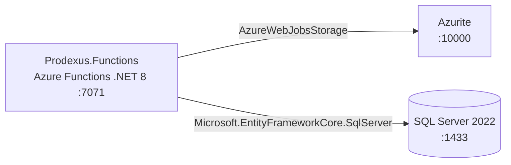

# Azure Debug Plan

> This plan is the source of truth for generating the
> VS Code debug setup in this workspace.
>
> **Status:** Implemented
> **Execution Mode:** Guided
> **Created:** 2026-10-02
> **Last Updated:** 2026-10-02

---

## Prerequisites

| Tool / Extension | Category | Service(s) | Installed | Version |
|------------------|----------|------------|-----------|---------|
| .NET SDK | Runtime / SDK | Prodexus.Functions | ✅ | 10.0.401 |
| Azure Functions Core Tools | Runtime | Prodexus.Functions | ✅ | 4.15.2 |
| Docker | Container runtime | Prodexus.Functions | ✅ | 29.6.2 |
| Docker Compose | Compose provider | Prodexus.Functions | ✅ | v5.3.1 |
| ms-azuretools.vscode-azurefunctions | VS Code extension | Prodexus.Functions | ✅ | 1.22.2 |

---

## Debug Configurations

Each checked row produces a VS Code debug configuration in `.vscode/launch.json`.

| Generate | Debug Config Name | Service Label | Service Root | Project Type | Runtime | Version | Azure Dependencies |
|----------|--------------------|---------------|--------------|--------------|---------|---------|---------------------|
| [x] | Prodexus.Functions (debug) | Prodexus.Functions | ./src/AchorPoint.Functions | functions | dotnet | 8.0 | Azure Storage, Azure SQL |

ℹ️ Project Type Descriptions

| Project Type | Description |
|-------------|-------------|
| functions | Azure Functions isolated worker with HTTP triggers |

---

## Orchestrator

| Orchestrator | Container Runtime | Compose Command | Description |
|-------------|-------------------|-----------------|-------------|
| Docker Compose | Docker | `docker compose` | Reuse the existing `docker-compose.yml` services; start Docker Desktop before running emulator tasks. |

---

## Emulators

| Dependent Service | Emulator | Purpose |
|-------------------|----------|---------|
| Azure Storage | Azurite Container | Functions host storage at ports 10000-10002. |
| Azure SQL | SQL Server 2022 Container | Local relational database on port 1433, as already defined in `docker-compose.yml`. |

---

## Architecture Diagram

The local Functions host runs on port 7071 and connects to Azurite for host storage and the Compose SQL Server for application data.

---

## Migrations

When selected, the generation phase creates automated VS Code tasks that apply the EF Core migrations before the app starts debugging.

| Generate | Service | Migration Tool |
|----------|---------|----------------|
| [x] | Prodexus.Functions | EF Core |

---

## API Test Collections

When selected, the generation phase creates runnable API smoke tests for the local HTTP triggers.

| Generate | Service | Description |
|----------|---------|-------------|
| [x] | Prodexus.Functions | 

HTTP Endpoints (2)
 GET /api/health (anonymous) POST /api/ingest/file (function authorization)
 |

---

## Convenience Scripts

No project script runner is present. Existing local commands are documented in `README.md`; no additional scripts are planned.

| Generate | Script | Registered In | Description |
|----------|--------|---------------|-------------|
| — | — | — | No script runner detected. |

## Debug Configuration Checklist

- ✅ Prodexus.Functions (debug) — host reported 2 functions loaded; GET /api/health returned HTTP 200 and POST /api/ingest/file inserted 2 records after migrations were applied.